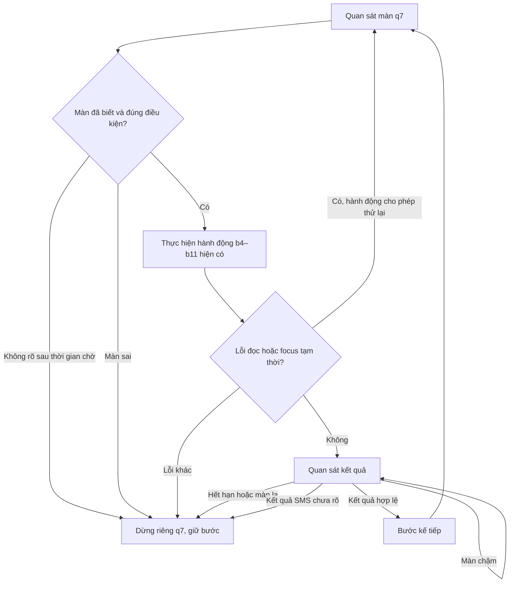

# Giai đoạn 2 — bản thử State Machine riêng q7

Ngày 14/11/2026. Bản này đã nối mã và kiểm thử mô phỏng; người dùng sẽ tự thử
q7 trên Swarmote thật. Không tự khởi động lại phiên tool đang mở vì dữ liệu mẻ
chỉ ở RAM. Tiến trình đang mở không tự nạp mã mới.

## Phạm vi và quan hệ với luồng cũ

- b1–b3 của q7 vẫn là ba lượt ngẫu nhiên. Mỗi lượt thử mở một thẻ danh
  mục, đọc cây Android đang hiện và bấm một mục con có nhãn trong 14 ảnh menu.
  Sau mỗi lượt thành công xem thêm 10 giây, tổng thêm 30 giây cho b1–b3. Nếu
  mục con mở trang khác, lượt kế chạm Browse menu; trước b4 cũng chạm Browse
  menu. Cập nhật 18/11: nếu thẻ đã mở sang trang khác thì xem đủ thời gian
  của lượt đó rồi mới hoàn tất; vẫn phải đủ cả ba lượt trước b4, không nhảy bước.
  Mỗi lượt q7 có hạn 90 giây để tìm mục con; hết hạn thì dừng tại lượt đó.
- q1–q6 và q8–q12 dùng `random_prefix.py`, nay chọn cả mục con đang hiện và
  xem 3–5 giây từng lượt; nhịp thêm 30 giây vẫn riêng trong `q7_random_prefix.py`.
- Chỉ q7 dùng `q7_state_machine.py` quanh các hành động b4–b11 hiện có trong
  `account_flow.build_common_steps`. q1–q6 và q8–q12 tiếp tục dùng bộ cũ.
- Dùng ADB, UI hierarchy và đường OCR dự phòng đã có. Không thêm AI Vision,
  cơ sở dữ liệu hay framework. Trạng thái bước và dấu SMS/Create nằm trong
  `PostMenuSession`/`RegistrationState` của q7 trong RAM.

## Sơ đồ

## Bảng trạng thái

Mỗi bước nhận màn trước thuộc `SPECS` hoặc một màn xác minh đến sớm đã biết và đúng SĐT; màn đến sớm được bỏ qua hành động cũ, không bấm lại. Màn `UNKNOWN`
được đọc lại tối đa 8 giây; màn đã biết nhưng sai nhánh và không phải kết quả đến sớm làm q7 dừng. Khi
`_wait_screen()` chạy cho q7, màn cũ hợp lệ được chờ trong thời hạn trạng thái;
màn khác nhánh bị dừng ngay. Kết quả
được quan sát sau hành động, không dựa vào mã trả về của ADB. Hết thời gian
trạng thái thì dừng q7, không gửi lại hành động khó đảo ngược.

| Bước | Màn trước | Kết quả cho phép | Hạn | Thử lại hành động |
| --- | --- | --- | ---: | ---: |
| b4 Sign In | MENU/IDENTIFIER | IDENTIFIER | 45 giây | 1 lần nếu lỗi tạm |
| b4a chạm ô SĐT | IDENTIFIER | IDENTIFIER, xác nhận focus bằng hàm cũ | 45 giây | 1 |
| b5 nhập SĐT | IDENTIFIER | Đọc lại đúng SĐT của q7 | 60 giây | 1 |
| b6 US +1 | IDENTIFIER/COUNTRY | Form có US +1 | 120 giây | 1 |
| b7 Continue | IDENTIFIER hoặc kết quả đã đến sớm | NEW_ACCOUNT/CREATE_FORM/WHATSAPP/SMS đúng SĐT | 60 giây | 0 |
| b8 Proceed | NEW_ACCOUNT/CREATE_FORM | CREATE_FORM | 60 giây | 0 |
| b9 nhập tên | CREATE_FORM | WHATSAPP/SMS | 60 giây | 0 |
| b10 gửi SMS | WHATSAPP/SMS | SMS | 60 giây | 0 |
| b11a chạm OTP | SMS | SMS, xác nhận focus bằng hàm cũ | 45 giây | 1 |
| b11 nhập OTP | SMS | SMS có đủ 6 số | 300 giây | 0 |
| b11b hoàn tất xác minh SMS | SMS | Đăng nhập dùng Verify, tạo dùng Create. Chấp nhận Trang chủ hoặc điều hướng đang hiện sau xác minh; b12 mở ba gạch, b13–b15 chọn ngẫu nhiên khác chuỗi giữa các máy, không Trang chủ. Màn chưa rõ thì dừng | 90 giây (chờ màn tới 45 giây) | 0 |

Các bước b4/b4a/b5/b6/b11a chỉ có tối đa một lần thử lại khi lỗi quan sát
tạm thời. Cột thử lại bằng 0 ở b10 nghĩa là lớp State Machine không chạy lại nguyên bước; hành động b10 dùng chung có thể chạm SMS lần thứ hai sau 20 giây **chỉ khi** đọc lại đúng màn WhatsApp và SĐT của q7, rồi dừng nếu vẫn không tới SMS. B11 bấm
Create hoặc Verify giữ dấu đã gửi riêng từ luồng chung, không phát lại mù quáng. `StateDetector`,
`ActionValidator`, `TransitionManager`, `ResultVerifier` và `RecoveryHandler`
cùng `UnknownStateHandler` là các thành phần của bản thử.

Lỗi mất ADB, lỗi đọc XML/OCR, màn sai, kết quả chưa xác minh, hết hạn và
người dùng Dừng có loại lỗi riêng trong q7. Lỗi focus/locator từ hàm chung
được giữ nguyên thông báo và chỉ thử lại khi trạng thái cho phép. Bản cũ
`PostMenuSession` tăng chỉ số bước sau khi action trả về; với q7, action b4–b11
chỉ trả về sau `ResultVerifier`, nên chưa có bằng chứng thì không tăng bước.

## Cách thử thật q7 sau khi người dùng sẵn sàng

1. Giữ hoặc ghi lại dữ liệu mẻ hiện tại trước khi tự mở bản mã mới; không giả
   định tiến trình đang mở đã nạp thay đổi. Không tạo lại Profile q7 trùng tên.
2. Chỉ chọn Máy 7 với hàng Amazon và ADB serial đúng q7. Quan sát b1, b2, b3:
   mỗi lượt mở một mục con, xem thêm khoảng 10 giây; sau lượt ba quay về menu.
3. Ở b4–b11, ghi màn hiện tại và thông báo bước nếu q7 dừng. Bấm Tiếp tục chỉ
   sau khi đã đối chiếu màn. Nếu sau Create/Verify về Trang chủ có tab Browse
   hiện rõ, q7 nối b12 để mở menu; màn lạ thì dừng. Không coi thông báo
   đã gửi Create là tài khoản thành công.

## Giới hạn

- Chưa có ADB/UI dump thật của q7 hoặc màn sau Create. Các mục con chỉ được
  chọn khi cây Android đưa ra nhãn và vùng bấm hợp lệ; nếu WebView không đưa
  ra dữ liệu này, b1–b3 có thể tiếp tục thử các thẻ khác nhưng chưa thể khẳng
  định sẽ mở được mục con trên q7 thật.
- OCR dự phòng đã có trong dự án nhưng môi trường `.venv` đang mở từng được
  ghi nhận lỗi ONNX Runtime khi import; chưa thay môi trường của tiến trình
  đang chạy.
- Test dùng dữ liệu mô phỏng và không gọi đăng ký tài khoản trên hệ thống thật.

Kiểm chứng tại thời điểm bàn giao: `python -m unittest discover -s tests -q`;
**334/334 PASS**. Test có màn muộn, focus, nút trùng, mất ADB, màn sai/UNKNOWN,
timeout, dừng q7 riêng và Làm lại xóa trạng thái RAM. Chưa có kết quả Swarmote
thật cho q7; bản thử chưa được nghiệm thu.
